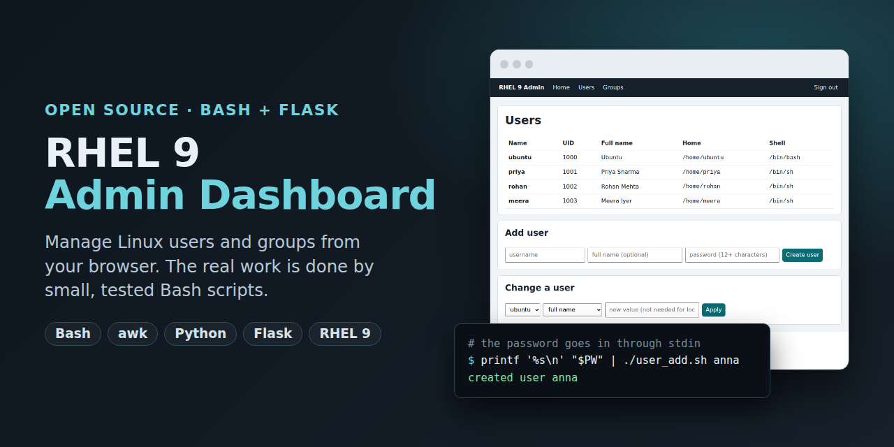
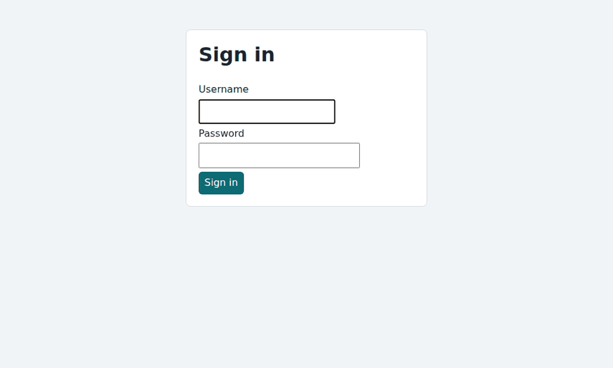
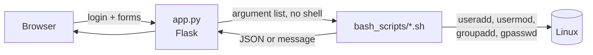

<p align="center">
  
</p>

<p align="center">
  <a href="https://github.com/dinesh-ajmera/rhel9_admin_dashboard/actions/workflows/ci.yml"></a>
  
  
  
  
  
</p>

<h3 align="center">Manage Linux users and groups from your browser.<br>The real work is done by small, tested Bash scripts.</h3>

<p align="center">
  <br>
  <sub>Recorded on a Linux test machine, using the real scripts (no mock data).</sub>
</p>

## Why this project

Sysadmins repeat the same jobs: add a user, lock an account, put someone in a group. I wanted a simple page for that, with the **system work in plain Bash** so it also works from the terminal and from cron, and a **thin Flask layer** for login and display.

- **Scripts first.** Nine small Bash scripts do everything. The web app only calls them.
- **Safe by design.** Names are validated, `root` and system accounts cannot be changed, passwords never appear on a command line.
- **Tested.** 38 Bash checks (including real create/modify/delete of a throw-away user) and 9 Python tests, run on every push.
- **Easy to read.** About 400 lines in total, no database, one dependency (Flask).

## How it works



| Script | What it does |
|---|---|
| `users.sh` / `groups.sh` | Print users / groups as **JSON** (one `awk` pass over `/etc/passwd`, `/etc/group`) |
| `user_count.sh` / `groups_count.sh` | Count regular users / groups (ID 1000 to 59999) |
| `user_add.sh` | Create a user. The password is read from **stdin** |
| `group_add.sh` | Create a group |
| `change_user_details.sh` | Change full name, shell, home directory; lock or unlock |
| `change_group_details.sh` | Rename a group; add or remove a member |
| `lib.sh` | Shared checks: `die`, `check_name`, `require_root`, protection of system accounts |

### Example

```console
$ ./bash_scripts/users.sh
[
  {"name":"alice","uid":1000,"gid":1000,"comment":"Alice Example","home":"/home/alice","shell":"/bin/bash"},
  {"name":"bob","uid":1001,"gid":1001,"comment":"Bob \"The Builder\" Smith","home":"/home/bob","shell":"/bin/bash"}
]

$ printf '%s\n' "$PASSWORD" | sudo ./bash_scripts/user_add.sh anna "Anna Verma"
created user anna

$ printf '%s\n' "$PASSWORD" | ./bash_scripts/user_add.sh 'bad;name'
error: invalid name: 'bad;name' (use a-z, 0-9, _ or -; max 32 chars)
```

## Quick start

Use a **practice VM**, not a production server (adding users needs root).

```bash
sudo dnf install -y python3 python3-pip git
git clone https://github.com/dinesh-ajmera/rhel9_admin_dashboard.git
cd rhel9_admin_dashboard
pip3 install -r requirements.txt

# choose a dashboard password (12+ characters) and store only its hash
export DASHBOARD_PASSWORD_HASH="$(python3 -c 'import getpass; from werkzeug.security import generate_password_hash as g; print(g(getpass.getpass()))')"

sudo -E python3 app.py          # open http://127.0.0.1:5000   (user: admin)
```

The app listens on `127.0.0.1` only. To use it from another computer: `ssh -L 5000:127.0.0.1:5000 your-server`.

## Tests

```bash
bash tests/run_tests.sh                 # read-only and input checks, any user
sudo bash tests/run_tests.sh            # also creates and deletes a throw-away user and group
python3 -m unittest discover -s tests   # Python side: login, CSRF, password via stdin, injection attempt
```

The scripts read `PASSWD_FILE` and `GROUP_FILE` from the environment, so the tests run them against fake files in `tests/fixtures/` (with quotes, backslashes and tabs in names on purpose).

<details>
<summary><b>Security details</b></summary>

- Every name is checked against `^[a-z_][a-z0-9_-]{0,31}$` before anything runs.
- Only IDs 1000 to 59999 can be changed, so `root`, `sshd`, `nobody` and friends are protected.
- Scripts use the official tools (`useradd`, `usermod`, `groupmod`, `gpasswd`), never `sed` on `/etc/passwd`.
- Passwords travel through **stdin** to `chpasswd`. Arguments are visible to every user in `ps`, stdin is not.
- If setting the password fails, the half-created user is removed again.
- Python starts scripts with an **argument list**, so no shell ever parses user input.
- Login with a salted password hash, CSRF token on every form, `HttpOnly` and `SameSite` cookies, debug mode off.
- Secrets come from environment variables; nothing sensitive is in the repository.

**Known limits:** the app runs as root in this version (fine for a practice VM). A production setup would run it unprivileged and allow only specific commands through `sudoers`, behind HTTPS, with login rate limiting and an audit log.
</details>

## What I learned

- Quote every variable, and validate input with an allow-list instead of trying to block bad characters.
- Use the proper tool (`usermod`) instead of editing system files with `sed`.
- Making scripts testable (configurable file paths, `trap` for clean-up) matters as much as making them work.
- `awk` can replace a whole pile of `cat | tail | head` pipelines and gives correct JSON.

## Roadmap

- [ ] Delete user (`user_delete.sh`) with an optional "remove home directory"
- [ ] Disk and memory overview page (`df`, `free`) as JSON
- [ ] Audit log of every change
- [ ] Run unprivileged with a `sudoers` allow-list

## License

[MIT](LICENSE)
